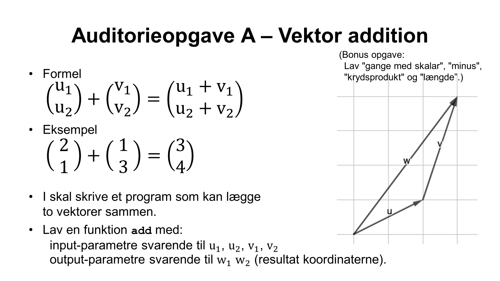
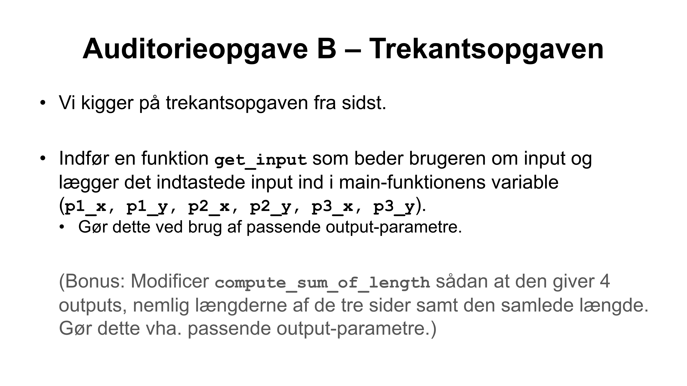

# Auditorieopgaver i Lektion 6

Live-coding af 'græsplæneudvidelse' tager udgangspunkt i [src/live.c](src/live.c).
Du kan evt. selv taste med her, eller du kan bare følge med på min skærm.

### Auditorieopgave A: Vektor addition
I [src/vector.c](src/vector.c)

---

### Auditorieopgave B: Trekantsopgaven
Med udgangspunkt i [src/trekant.c](src/trekant.c)

